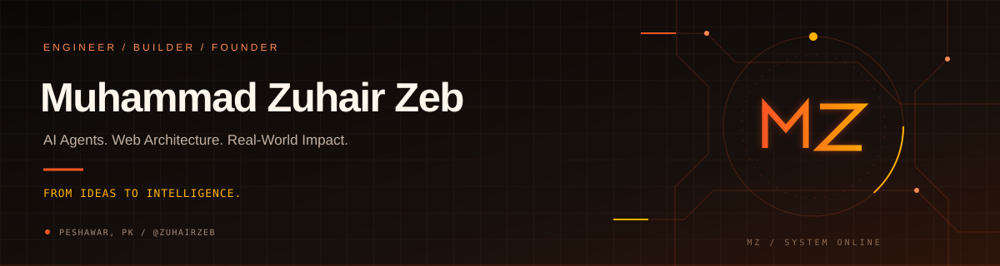
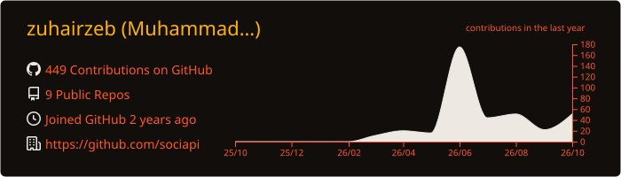
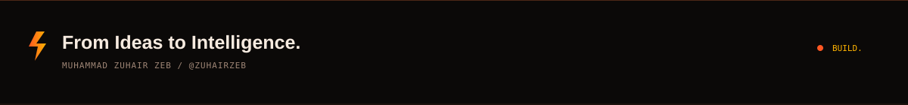

<div align="center">



<a href="https://xuhair.netlify.app">
  
</a>

<p>
  <a href="https://xuhair.netlify.app"></a>
  <a href="https://linkedin.com/in/zuhairzeb"></a>
  <a href="https://sociapis.vercel.app"></a>
  <a href="mailto:xuhairxeb@gmail.com"></a>
</p>

<p>
  
  
  
  
  
</p>


</div>

---

## `01 // SYSTEM ARCHITECTURE & IDENTITY`

<table>
<tr>
<td width="58%" valign="top">

### Muhammad Zuhair Zeb
**AI Application Developer · WordPress & WooCommerce Architect · Community Founder**

Final-year **BS Artificial Intelligence** student at **Islamia College University Peshawar, Pakistan**. Since **2021**, I have engineered **20+ commercial websites, multivendor eCommerce stores, and custom software platforms**.

Today, I bridge production web architecture with **multi-provider LLM orchestration, Model Context Protocol (MCP) agents, RAG pipelines, and business automation**—while leading **Sociapi Society** to connect students with hands-on AI & engineering.

> **Motto:** *"From Ideas to Intelligence."*

</td>
<td width="42%" valign="top">

```toml
[engineer]
handle     = "@zuhairzeb"
base       = "Peshawar, Pakistan"
degree     = "BS Artificial Intelligence"
alma_mater = "Islamia College Univ."
shipped    = "20+ Web & eCommerce Builds"
leadership = "Founder @ Sociapi Society"

[focus_2026]
agents = ["MCP Servers", "Multi-Agent RAG"]
infra  = ["Key Rotation", "Provider Failover"]
active = ["Morrow AI", "RepoGuard", "Nexus ERP"]
```

</td>
</tr>
</table>

---

## `02 // FEATURED SYSTEMS & RESEARCH`

<table>
<tr>
<td width="50%" valign="top">

### `01` Morrow AI
 

Unified personal AI workspace orchestrating multiple LLM providers, resilient tool execution, document intelligence, and memory.
- **Failover Routing:** Automatic API key rotation & zero-downtime provider fallback
- **Stateful Context:** Persistent conversation history, memory & document processing
- **Developer Tools:** Custom AI commands, code assistance & response recovery

`Python` · `LangChain` · `OpenAI` · `Groq` · `Gemini`

</td>
<td width="50%" valign="top">

### `02` RepoGuard
 

**MCP-based AI security agent** translating dense GitHub vulnerability findings into clear remediation steps in **English & Roman Urdu**.
- **Native MCP Tools:** Direct GitHub security advisory & scan report ingestion
- **Bilingual Triage:** Actionable root-cause explanations in English & Roman Urdu
- **Verification:** Structured explanation accuracy & patch guidance evaluation

`Python` · `Model Context Protocol` · `AI Agents` · `GitHub`

</td>
</tr>
<tr>
<td width="50%" valign="top">

### `03` Sociapi Nexus
 

Centralized organizational ERP governing Sociapi Society's 39 core team members, chapters, and operations.
- Role-Based Access Control (RBAC) & department workflows
- Real-time member directory, attendance ledger & executive dashboards

`React` · `TypeScript` · `Supabase`

</td>
<td width="50%" valign="top">

### `04` WhatsApp AI Assistant
 

Knowledge-connected WhatsApp AI agent built for automated multilingual support with seamless human handoff.
- Domain knowledge-base retrieval & multi-turn conversation memory
- Live human-in-the-loop takeover controls over Baileys socket

`Node.js` · `Baileys` · `RAG` · `LLM APIs`

</td>
</tr>
<tr>
<td colspan="2" valign="top">

### `05` HomeItems Marketplace — *Commercial Multivendor eCommerce*
 &nbsp; Full-scale multivendor retail ecosystem featuring isolated **vendor onboarding & seller dashboards**, **payment gateway & zone shipping rules**, and **high-speed faceted catalog filtering**. &nbsp; `WordPress` · `WooCommerce` · `PHP` · `MySQL`

</td>
</tr>
</table>

<details>
<summary><strong>⚡ 06 // Expand Additional Shipped Software & Client Platforms (7+ Builds)</strong></summary>
<br/>

| Platform / Product | Category | Engineering Purpose |
| :--- | :--- | :--- |
| **Sanitary POS Software** | Retail Software | Point-of-Sale billing, inventory ledger & invoicing system |
| **Bulk Outreach Email Generator** | AI Automation | Automated personalized outreach copy & campaign generation |
| **Bulk Certificate Generator** | Workflow Tooling | High-volume automated credential creation for bootcamps & events |
| **Sociapi Society Website** | Community Portal | Official student tech community hub ([sociapis.vercel.app](https://sociapis.vercel.app)) |
| **Ospherics Pharmaceuticals** | Corporate Web | Healthcare & pharmaceutical corporate product platform |
| **TecWideBlog** | Digital Publishing | Technical SEO-tuned content publishing architecture |
| **Personal Portfolio** | Web Showcase | Developer portfolio & client case showcase ([xuhair.netlify.app](https://xuhair.netlify.app)) |

</details>

---

## `03 // TECHNICAL ARSENAL`

<table>
<tr>
<td width="28%" valign="middle" align="center">
  <strong>AI, LLMs &amp; Agents</strong><br/><br/>
  
</td>
<td width="72%" valign="top">
  • <strong>Agentic Systems:</strong> Multi-Agent Workflows, Model Context Protocol (MCP), Function &amp; Tool Calling<br/>
  • <strong>Resilient LLM Infra:</strong> Multi-Model Routing, Automatic API Key Rotation &amp; Provider Fallback<br/>
  • <strong>Knowledge &amp; Context:</strong> RAG, Knowledge Bases, Conversation Memory, Prompt Engineering
</td>
</tr>
<tr>
<td width="28%" valign="middle" align="center">
  <strong>Web &amp; eCommerce</strong><br/><br/>
  
</td>
<td width="72%" valign="top">
  • <strong>WordPress &amp; WooCommerce:</strong> Custom Themes/Plugins, Multivendor Marketplaces, Elementor Pro<br/>
  • <strong>Modern Frontend:</strong> Typed React &amp; TypeScript Applications, Component UI Systems, Tailwind CSS<br/>
  • <strong>Optimization:</strong> Core Web Vitals, Technical SEO, Security Hardening &amp; UI/UX Design
</td>
</tr>
<tr>
<td width="28%" valign="middle" align="center">
  <strong>Backend &amp; Data</strong><br/><br/>
  
</td>
<td width="72%" valign="top">
  • <strong>APIs &amp; Services:</strong> REST API Architecture, Node.js/Express Services, PHP Custom Backends<br/>
  • <strong>Data &amp; Security:</strong> PostgreSQL, MySQL, Supabase Realtime, Redis Caching, RBAC Authentication
</td>
</tr>
<tr>
<td width="28%" valign="middle" align="center">
  <strong>DevOps &amp; Delivery</strong><br/><br/>
  
</td>
<td width="72%" valign="top">
  • <strong>Cloud &amp; CI/CD:</strong> Docker, GitHub Actions, Linux Administration, Vercel, Netlify &amp; cPanel<br/>
  • <strong>Production Ops:</strong> SSL Provisioning, DNS Architecture, Zero-Downtime Migrations &amp; Technical Mentoring
</td>
</tr>
</table>

---

## `04 // LEADERSHIP & TRAJECTORY`

<table>
<tr>
<td width="55%" valign="top">

### Founder @ [Sociapi Society](https://sociapis.vercel.app)
 

Student-led technology community helping students build practical AI & software skills through real-world workshops, bootcamps, and collaborative engineering.

<p>
  
  
  
</p>

**2026 Flagship Events:**


  
  
  

</td>
<td width="45%" valign="top">

### Milestone Arc (2021 → 2026)

- **`2026`** — Building **Morrow AI**, **RepoGuard (MCP)** & **Sociapi Nexus ERP**
- **`2025`** — Founded **Sociapi Society** · *Top Performer Award (Dosti)*
- **`2024`** — *WordPress Mentor* @ Digital Empowerment Network · *PAFLA*
- **`2023`** — Advanced BS AI studies + full-stack client systems
- **`2022`** — Scaled into multivendor WooCommerce & global clients
- **`2021`** — Started WordPress, PHP & Web Engineering journey

<details>
<summary><strong>Honors &amp; Credentials (5)</strong></summary>

- **Top Performer Volunteer Award** — Dosti Peshawar (2025)
- **WordPress Mentor Recognition** — Digital Empowerment Network (2024)
- **WordPress Virtual Internship** — Digital Empowerment Network (2024)
- **Web Development Certification** — Cyberseez IT House (2024)
- **Official Member** — Pakistan Freelancers Association / PAFLA (2024)

</details>

</td>
</tr>
</table>

---

## `05 // GITHUB TELEMETRY`

<div align="center">




<br/><br/>


<br/><br/>



<br/><br/>



**Earned trophies:** Village Elder (S) · Rainbow Lang (S) · New User (S) · Hyper Committer (A, 392 commits) · First Repository (C)

</div>

---

## `06 // LET'S BUILD TOGETHER`

<div align="center">

**Open for AI Application & Agent Development · MCP Integrations · WordPress & Multivendor WooCommerce · Technical Collaborations**

<p>
  <a href="https://xuhair.netlify.app"></a>
  <a href="https://linkedin.com/in/zuhairzeb"></a>
  <a href="https://sociapis.vercel.app"></a>
  <a href="mailto:xuhairxeb@gmail.com"></a>
</p>



</div>
